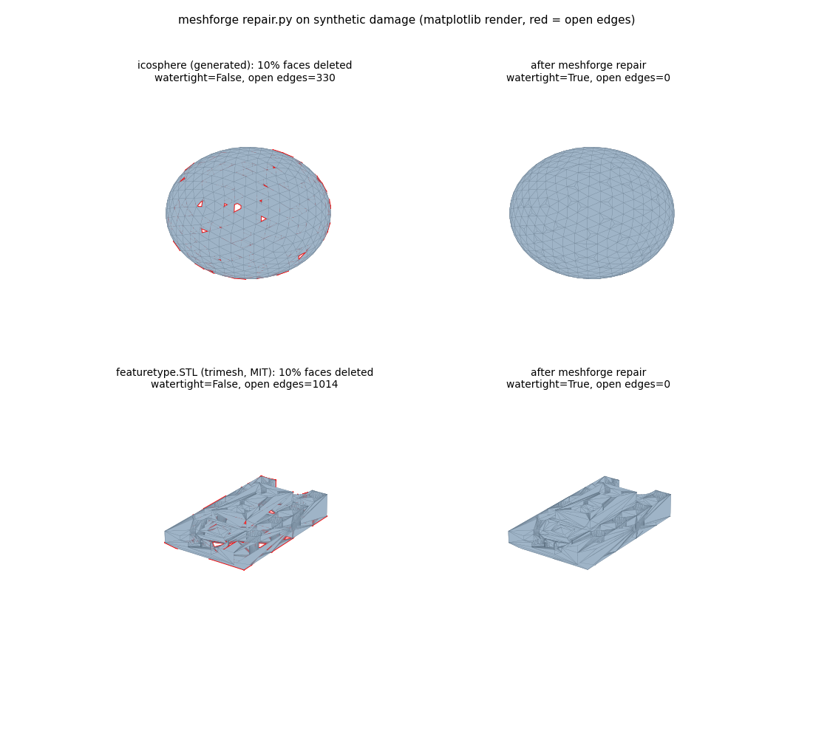

# meshforge

Local print-prep for AI-generated 3D meshes: repairs holes and flipped faces, picks a print orientation, splits parts that exceed the plate, and writes a Bambu `.3mf`.



The meshes in the image are damaged on purpose by `scripts/bench_printprep.py` (seeded face deletion), then repaired by `repair.py`. The damage is synthetic, not a real generator failure.

## Quickstart

```bash
pip install -r requirements.txt pytest
python -m pytest tests/ -q                       # 26 tests
python scripts/bench_printprep.py                # writes results/bench_printprep.json
python scripts/render_repair.py                  # writes docs/repair_before_after.png
python -m backend.cli --mesh path/to/model.glb   # repair -> color -> orient -> split -> analyze -> .3mf
```

The CLI writes `<out-dir>/run_<timestamp>/model.3mf` and exits 0 on success, 1 if a stage failed. `--slice` also runs Bambu Studio; it is off by default (see Limits).

## How it works

1. `repair.py` merges vertices, drops duplicate and degenerate faces, fixes winding and normals. If the mesh is still open it tries `trimesh.repair.fill_holes`, and keeps that result only if it is watertight. Otherwise it caps each boundary loop with a centroid fan.
2. `color.py` quantizes vertex color to an AMS filament palette.
3. `orient.py` scores the 6 axis poses plus convex-hull facet poses on support-needing area, overhang area, footprint and height, and rests the part on the best one.
4. `split.py` cuts parts that exceed the 256 mm plate and adds dowel/socket joints (manifold3d booleans).
5. `analyze.py` reports print-failure risks (taxonomy in `docs/PRINT_FAILURES.md`); `assemble3mf.py` writes the project.
6. Image to mesh (`backend/generate.py`) is a client for Hunyuan3D-2 running in a free Kaggle or Colab notebook. It is a remote stub here: it was not run for these results. See `NOTEBOOK.md`.

## Results

Command: `python scripts/bench_printprep.py`. Machine: arm64 macOS, Python 3.9.6, trimesh 4.12.2. Meshes: 2 files from trimesh/models (MIT) plus generated icosphere, box, torus, capsule. Each gets 6 seeded defects (2% or 10% faces deleted, 30% faces flipped, 5% duplicated, triangle soup, a combination), 36 cases. A case passes if the result is watertight, winding-consistent and has positive volume. Sources: `results/INDEX.md`.

| Metric | Ours | Market standard | Goal |
|---|---|---|---|
| Repair success, 36 synthetic cases | 97.2% (35/36); 83.3% before this change | No comparable published rate found. In-box baseline (merge + `fill_holes` only): 36.1% | 1.5x fewer errors than baseline = 4.3% error; ours is 2.8% |
| Median repair time, median 2761 faces | 0.04 s | none found | none set |
| Support-needing area, share of surface, 18 cases | 0.123 (random pose) to 0.094 (optimized), 24% less | none found | none set |

Market standard: no paper or tool publishes a repair success rate on a shared mesh set that this could be compared with. Thingi10K reports how broken real files are (29% of models have more than one component, 45% are not self-intersection-free; https://arxiv.org/html/1605.04797v2) but not how well any repair tool does. admesh, PrusaSlicer and MeshLab were not run here. The goal row therefore uses the in-box baseline, which is a weak comparator.

## Limits

- The defects are synthetic. Real generator output has self-intersections and thin shells that this benchmark does not contain.
- One case fails: icosphere with the combined defect (1234 faces).
- Hole capping with a centroid fan adds faces and makes flat, lumpy patches. It closes the mesh; it does not restore the original surface.
- Orientation is a heuristic over about 24 candidate poses. No slicer was run to check the support volume it predicts.
- The slicer step is off by default after concurrent Bambu Studio launches froze the machine once; `slicer.py` now takes a file lock.
- Image-to-3D needs a manually launched notebook with an ephemeral `gradio.live` URL (about 72 h). Not run for these results.
- Bambu's `paint_color` blob is not written. Color goes in as a 3MF `ColorGroup`, which Bambu Studio reads but does not bind to AMS slots.
- Tested on Python 3.9 locally; CI uses 3.12. No real printer was involved.

## Layout

`backend/` (generate, cli, `printprep/`), `scripts/` (bench, render), `results/`, `docs/`, `tests/`, `data/` (two bench meshes, MIT, see `data/README.txt`), `ARCHITECTURE.md`, `NOTEBOOK.md`.

## License

MIT. See `LICENSE`.
